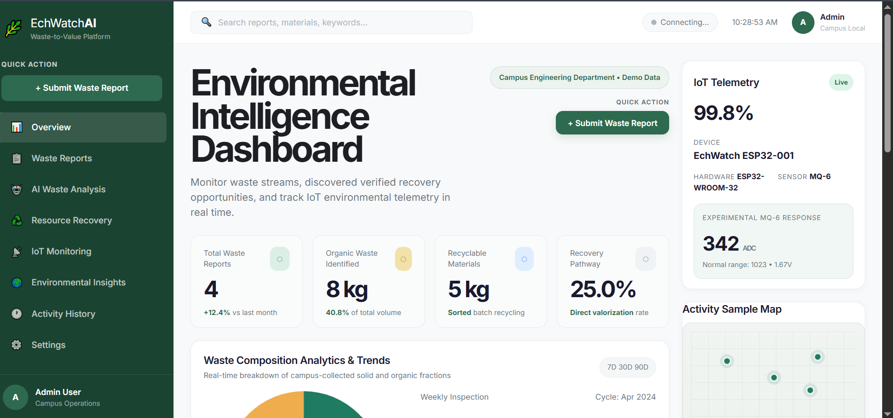

🌍 EchWatch AI
Intelligent Waste Identification, Resource-Recovery Guidance & Experimental Device Monitoring
EchWatch AI is an environmental technology platform designed to support smarter waste management through artificial intelligence, community reporting and experimental IoT monitoring.
The platform aims to transform waste observations into useful information by assisting with waste identification, suggesting potential recovery pathways and displaying experimental sensor data.
🎯 Project Objectives
Support submission and documentation of waste reports.
Use AI-assisted image analysis to suggest possible waste categories.
Recommend potential recovery pathways such as reuse, recycling and composting.
Allow human reviewers to confirm or correct AI suggestions.
Receive experimental sensor readings from ESP32-based devices.
Present reports, recovery information and device readings through a dashboard.
✨ Core Features
1. Waste Reporting
Users can submit waste observations with descriptions and supporting images.
2. AI-Assisted Waste Identification
AI image analysis assists in suggesting possible waste categories and explaining visible evidence and uncertainty.
3. Resource-Recovery Guidance
The system connects waste categories with possible recovery pathways, subject to appropriate review.
4. IoT Device Monitoring
An ESP32-based device interface supports experimental sensor-data monitoring.
5. Dashboard
A central interface brings together waste reports, recovery information and device-monitoring data.
🛠️ Technology Stack
Component	Technology
Frontend	HTML, CSS, JavaScript
Runtime	Node.js
Backend	Express.js 5
Database	SQLite
Database driver	better-sqlite3
Authentication utilities	bcryptjs
File uploads	Multer
Environment configuration	dotenv
Device communication	MQTT
Unique identifiers	uuid
Hardware interface	ESP32
Experimental sensor	MQ-6
🏗️ System Architecture
Waste reporting flow
User → Web Interface → Express API → Validation → Database → AI Analysis → Human Review → Dashboard
Device monitoring flow
ESP32 → Device Communication Interface → Backend → Database → Dashboard
🚀 Getting Started
Prerequisites
Install the following before running the project:
Node.js
npm
Git
1. Clone the repository
git clone https://github.com/Atembe-Nemiah/EchWatch-AI.git
2. Enter the project directory
cd EchWatch-AI
3. Install dependencies
npm install
4. Configure environment variables
Configure your local .env file according to the project’s existing environment requirements.
Never publish API keys, passwords or device credentials.
5. Start the application
Normal startup:
npm start
Development mode:
npm run dev
🔐 Responsible AI & Safety
EchWatch AI is a decision-support prototype, not a substitute for laboratory testing or professional environmental assessment.
AI classifications are suggestions, not confirmed laboratory findings.
Human review is required before final classification decisions.
An image alone cannot establish chemical composition, contamination or safety.
MQ-6 readings are experimental LPG-response data, not methane concentration or biogas-quality measurements.
The prototype is not a certified gas safety alarm or industrial control system.
🔮 Future Development
Improve AI classification using validated waste-image datasets.
Integrate verified local recycling and waste-management partners.
Expand privacy-conscious environmental reporting and mapping.
Improve IoT device monitoring.
Explore a mechanically assisted waste-sorting demonstrator with appropriate engineering and safety validation.
📌 Project Status
Development stage: Hackathon prototype / ongoing development.
EchWatch AI is being developed as an extensible environmental technology platform, with further testing, validation and improvements planned.
⸻
Built with a vision for a cleaner, healthier community. 🌱

## project screenshots

## Main Dashboard

